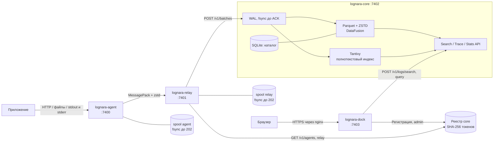

<div align="center">

# Lognara

**Сбор, хранение, поиск и аналитика логов на Rust**


</div>

Lognara принимает логи приложений, надёжно доставляет их на центральный сервер и позволяет искать по ним и строить статистику. Три небольших сервиса на Rust: **agent** живёт в контейнере рядом с приложением, **relay** один на машину, **core** хранит логи и отвечает на запросы. Веб-интерфейс **dock** показывает логи в браузере за nginx. Core пишет приём в WAL, сохраняет данные в сегменты Parquet + ZSTD, ищет через Tantivy и считает аналитику через DataFusion.

## Как это работает



1. Приложение отправляет лог (text, JSON или байты) на `POST http://127.0.0.1:7400/v1/logs`, либо агент читает его файлы и захватывает stdout/stderr через `lognara-agent run -- программа аргументы`.
2. Агент сохраняет весь запрос на диск до `202` и отправляет пачку в relay с персональным Bearer-токеном агента, когда набрался `LOGNARA_BATCH_SIZE` или прошёл `LOGNARA_FLUSH_INTERVAL_MS`; размер пачки также ограничен байтами.
3. Relay проверяет токен по списку своих агентов из core до чтения тела, разбирает записи в события и сохраняет все допустимые части запроса на диск до `202`. По количеству событий или таймеру отправляет сохранённые тела в core с персональным токеном relay. Пока downstream недоступен, обе очереди остаются на диске.
4. Core проверяет зарегистрированный токен relay и подтверждает пачку (`204`) только после fsync WAL, затем материализует её в сегмент и публикует для поиска и аналитики.

### Serilog (.NET)

Приложения на .NET отправляют логи через Serilog.Sinks.Http с форматтером из Serilog.Expressions (`ExpressionTemplate`). Установите пакеты `Serilog.Sinks.Http` и `Serilog.Expressions`. Агент работает в контейнере приложения, поэтому адрес всегда `http://127.0.0.1:7400/v1/logs`.

Каждое событие должно быть в каноническом JSON Lognara: relay раскладывает по полям только канонические ключи, остальные уходят в `attributes`. Массив JSON агент делит на записи, по одной на элемент. Пачку держите меньше 1 MiB (`batchSizeLimitBytes`): агент принимает тело не больше 2 MiB.

```csharp
using Serilog;
using Serilog.Templates;
using Serilog.Sinks.Http.BatchFormatters;

Log.Logger = new LoggerConfiguration()
    .WriteTo.Http(
        requestUri: "http://127.0.0.1:7400/v1/logs",
        queueLimitBytes: null,
        batchSizeLimitBytes: 1024 * 1024,
        textFormatter: new ExpressionTemplate(
            "{ {timestamp: UtcDateTime(@t), level: @l, message: @m, exception: @x, attributes: @p} }\n"),
        batchFormatter: new ArrayBatchFormatter())
    .CreateLogger();
```

Пример C# в этом репозитории не компилировался и не запускался. Перед использованием проверьте его в вашем приложении.

| Поле Lognara | Откуда в шаблоне | Что попадает |
|---|---|---|
| `timestamp` | `@t` через `UtcDateTime` | время события |
| `level` | `@l` | `Verbose`, `Information`, `Warning` и `Critical` понимаются как `trace`, `info`, `warn` и `fatal`; `Debug`, `Error`, `Fatal` совпадают с каноническими |
| `message` | `@m` | текст события с подставленными значениями |
| `attributes` | `@p` | все свойства Serilog; у сервисов с `ServiceMetrics` здесь окажется объект `Metrics` |
| прочие ключи | `exception` (`@x`) | не канонические ключи уходят в `attributes` как есть |

## Возможности

| Компонент | Что делает | Ключевые свойства |
|-----------|------------|-------------------|
| [`Lognara-agent`](Lognara-agent) | Принимает HTTP, читает файлы и stdout/stderr, сохраняет на диск, отправляет в relay | text/NDJSON/multiline для файлов и потоков; HTTP text/JSON/bytes; пачки MessagePack + zstd; точные повторы с backoff; переполнение HTTP даёт `503` без вытеснения |
| [`Lognara-relay`](Lognara-relay) | Разбирает записи в события, группирует по источнику, отправляет в core | spool на диске с лимитом; порядок пачек сохраняется; деление по байтовым лимитам core |
| [`Lognara-dock`](Lognara-dock) | Веб-интерфейс: вход и логи в реальном времени | вход по htpasswd (bcrypt) и passkey; сессии и ключи в SQLite; смена пароля переписывает htpasswd; SSE-лента по поиску core; страница «Метрики» с графиками и редактор правил |
| [`Lognara-core`](Lognara-core) | Хранит логи, ищет и считает статистику | WAL + fsync до ACK; дедупликация по SHA-256; полнотекстовый поиск, trace lookup, гистограммы и group-by; retention; точки метрик ServiceMetrics и regex-правила; метрики Prometheus |

Подключение [Nginx, PostgreSQL, Seq и MinIO](Lognara-agent/docs/log-sources.md#подключение-приложений), JSON-конфигурация источников и режим `run` описаны в [руководстве агента](Lognara-agent/docs/log-sources.md).

### Гарантии доставки

- Корректные запросы, получившие `202` от agent или relay, восстановятся после перезапуска и временной недоступности downstream. Подтверждение следует после синхронизации всей группы на постоянном диске.
- Agent удаляет исходные данные после ACK relay, relay после ACK core. Квота и ошибки диска дают `503` без удаления принятой очереди. HTTP-отказы сохраняют данные и останавливают текущую попытку с диагностикой; повторы идут по таймеру/backoff. При `4xx` agent также приостанавливает новый приём.
- Доставка допускает дубликаты. Подготовленные тела повторяются теми же байтами; core дедуплицирует повтор одного тела по SHA-256. Повтор исходного запроса может получить новые ID событий.
- Отправляющее приложение должно повторять запросы без успешного ответа, в том числе после `503` или разрыва соединения. Его реализация не входит в проект.
- Файлы восстанавливаются по checkpoint после durable-записи в spool; crash между этими шагами допускает повторы. Сохраняйте несжатые ротации до дочитывания. stdout/stderr при перегрузке продолжают освобождаться с учётом потерь; консольная копия имеет отдельный счётчик потерь.
- Гарантия требует исправного постоянного хранилища. Повреждение или удаление диска, временные volumes и неподтверждённые запросы без повтора ею не покрываются.

## Быстрый старт

Нужен Rust 1.94 или новее. Общего Cargo workspace нет, каждый сервис собирается отдельно:

```sh
cargo build --release --manifest-path Lognara-core/Cargo.toml --bin lognara-core
cargo build --release --manifest-path Lognara-relay/Cargo.toml
cargo build --release --manifest-path Lognara-agent/Cargo.toml
```

Сначала запускаются core и dock; в dock на странице «Подключения» создаются relay, затем агент с выбором relay. Токен показывается один раз. Локальная альтернатива без dock — admin API (нужны `curl` и `jq`):

```sh
# Терминал 1: core
LOGNARA_ADMIN_TOKEN=admin-secret \
LOGNARA_QUERY_TOKEN=query-secret \
LOGNARA_DATA_DIR=/tmp/lognara-demo/core \
Lognara-core/target/release/lognara-core

# Терминал 2: регистрация, затем relay. Сохраните ответы с токенами.
RELAY=$(curl --fail-with-body -s http://127.0.0.1:7402/v1/admin/relays \
  -H 'Authorization: Bearer admin-secret' -H 'Content-Type: application/json' \
  -d '{"name":"local-relay"}')
RELAY_ID=$(printf '%s' "$RELAY" | jq -r '.relay.id')
export LOGNARA_RELAY_CORE_TOKEN=$(printf '%s' "$RELAY" | jq -r '.token')
AGENT=$(curl --fail-with-body -s http://127.0.0.1:7402/v1/admin/agents \
  -H 'Authorization: Bearer admin-secret' -H 'Content-Type: application/json' \
  -d "{\"name\":\"local-agent\",\"relay_id\":$RELAY_ID}")
export LOGNARA_AGENT_TOKEN=$(printf '%s' "$AGENT" | jq -r '.token')
# Впишите LOGNARA_AGENT_TOKEN в окружение терминала 3.
LOGNARA_CORE_URL=http://127.0.0.1:7402/v1/batches \
LOGNARA_CORE_TOKEN="$LOGNARA_RELAY_CORE_TOKEN" \
LOGNARA_RELAY_MEMORY_MB=2048 \
LOGNARA_SPOOL_DIR=/tmp/lognara-demo/relay-spool \
LOGNARA_FLUSH_INTERVAL_MS=1000 \
Lognara-relay/target/release/lognara-relay

# Терминал 3: agent с персональным токеном из регистрации
LOGNARA_SERVICE=api \
LOGNARA_SPOOL_DIR=/tmp/lognara-demo/agent-spool \
LOGNARA_SERVER=local \
LOGNARA_BACKEND=demo \
LOGNARA_RELAY_TOKEN="$LOGNARA_AGENT_TOKEN" \
LOGNARA_RELAY_URL=http://127.0.0.1:7401/v1/batches \
LOGNARA_FLUSH_INTERVAL_MS=1000 \
Lognara-agent/target/release/lognara-agent
```

Готовый стенд с core и dock: [`Example/README.md`](Example/README.md).

Для демо интервалы сокращены до секунды: по умолчанию relay отправляет раз в 60 секунд, а агент по умолчанию ищет relay по имени `lognara-relay` в сети контейнеров.

Отправьте лог и найдите его:

```sh
curl -X POST http://127.0.0.1:7400/v1/logs \
  -H 'Content-Type: application/json' \
  -d '{"level":"error","message":"connection refused"}'

# через пару секунд
curl -X POST http://127.0.0.1:7402/v1/logs/search \
  -H 'Authorization: Bearer query-secret' \
  -H 'Content-Type: application/json' \
  -d '{"from":"2020-01-01T00:00:00Z","to":"2100-01-01T00:00:00Z","filters":{"level":["error"]},"text":{"query":"connection refused","mode":"phrase"}}'
```

## Порты и параметры

Все параметры задаются переменными окружения `LOGNARA_*` и проверяются при старте; при ошибке сервис завершается с кодом 1 и называет переменную.

| Сервис | Порт по умолчанию | Обязательные | Главные необязательные |
|--------|-------------------|--------------|------------------------|
| agent | `127.0.0.1:7400` | `LOGNARA_SERVICE`, `LOGNARA_SERVER`, `LOGNARA_BACKEND`, `LOGNARA_RELAY_TOKEN` | `LOGNARA_RELAY_URL`, `LOGNARA_BATCH_SIZE` (1000), `LOGNARA_FLUSH_INTERVAL_MS` (5000) |
| relay | `127.0.0.1:7401` | `LOGNARA_CORE_URL`, `LOGNARA_CORE_TOKEN` | `LOGNARA_SPOOL_DIR`, `LOGNARA_SPOOL_MAX_MB` (1024), `LOGNARA_FLUSH_INTERVAL_MS` (60000), `LOGNARA_BATCH_SIZE` (10000) |
| core | `127.0.0.1:7402` | `LOGNARA_ADMIN_TOKEN`, `LOGNARA_QUERY_TOKEN` | `LOGNARA_DATA_DIR`, `LOGNARA_RETENTION_SECONDS` (604800), `LOGNARA_SERIES_COMPACT_QUIET_SECONDS` (3600), `LOGNARA_SERIES_RAW_DAYS` (7), `LOGNARA_SERIES_HOURLY_DAYS` (35), `LOGNARA_SERIES_ROLLUP_HOUR_UTC` (0), `LOGNARA_SERIES_ROLLUP_PAUSE_MS` (1000) |
| dock | `127.0.0.1:7403` | `LOGNARA_DOCK_PUBLIC_URL`, `LOGNARA_DOCK_CORE_URL`, `LOGNARA_DOCK_CORE_TOKEN`, `LOGNARA_DOCK_CORE_ADMIN_TOKEN` | `LOGNARA_DOCK_HTPASSWD_FILE`, `LOGNARA_DOCK_DATA_DIR`, `LOGNARA_DOCK_SESSION_TTL_SECONDS` (43200) |

<details>
<summary>Все параметры agent и relay</summary>

**agent**

| Переменная | По умолчанию | Назначение |
|---|---|---|
| `LOGNARA_SERVICE` | обязательна | имя сервиса |
| `LOGNARA_SERVER` | обязательна | сервер или нода |
| `LOGNARA_BACKEND` | обязательна | backend |
| `LOGNARA_ENVIRONMENT` | нет | окружение |
| `LOGNARA_SERVICE_INSTANCE` | `$HOSTNAME`, если задан | экземпляр сервиса |
| `LOGNARA_BATCH_SIZE` | `1000` | размер пачки в записях |
| `LOGNARA_FLUSH_INTERVAL_MS` | `5000` | как часто отправлять накопленное |
| `LOGNARA_MAX_BUFFER` | `100000` | лимит подтверждённых записей на диске, не меньше `BATCH_SIZE`; сверх него `503` |
| `LOGNARA_MAX_BUFFER_BYTES` | `67108864` | бюджет моделей, индекса, сериализации, источников и отправляемой пачки |
| `LOGNARA_SOURCES_FILE` | нет | JSON с файловыми источниками и настройками stdout/stderr для `run` |
| `LOGNARA_MAX_BATCH_BYTES` | `8388608` | максимум MessagePack и сжатой пачки, не более 8 MiB |
| `LOGNARA_MAX_RECORD_BYTES` | `2097152` | максимум payload одной записи, не более 2 MiB |
| `LOGNARA_SPOOL_DIR` | `/var/lib/lognara-agent/spool` | каталог постоянной очереди agent |
| `LOGNARA_SPOOL_MAX_MB` | `1024` | квота тел очереди; отдельно до 8 MiB для pending |
| `LOGNARA_LISTEN_ADDR` | `127.0.0.1:7400` | адрес приёма |
| `LOGNARA_RELAY_URL` | `http://lognara-relay:7401/v1/batches` | адрес relay |
| `LOGNARA_RELAY_TOKEN` | обязательна | персональный токен агента из dock |

**relay**

| Переменная | По умолчанию | Назначение |
|---|---|---|
| `LOGNARA_CORE_URL` | обязательна | адрес core, схема `http` или `https` |
| `LOGNARA_CORE_TOKEN` | обязательна | персональный токен relay из dock |
| `LOGNARA_FLUSH_INTERVAL_MS` | `60000` | интервал отправки в core |
| `LOGNARA_BATCH_SIZE` | `10000` | при таком числе событий пачка уходит раньше интервала |
| `LOGNARA_MAX_BUFFER` | `100000` | лимит подтверждённых событий на диске; сверх него агенты получают `503` |
| `LOGNARA_LISTEN_ADDR` | `127.0.0.1:7401` | адрес приёма от агентов; для Docker задайте `0.0.0.0:7401` |
| `LOGNARA_SPOOL_DIR` | `/var/lib/lognara-relay/spool` | каталог spool |
| `LOGNARA_SPOOL_MAX_MB` | `1024` | лимит spool на диске |
| `LOGNARA_CORE_MAX_BODY_BYTES` | `67108864` | максимум сжатой пачки, не больше лимита core |
| `LOGNARA_CORE_MAX_DECODED_BYTES` | `268435456` | максимум MessagePack до сжатия, не больше лимита core |
| `LOGNARA_CORE_MAX_MODEL_BYTES` | `268435456` | бюджет модели, не больше лимита core |
| `LOGNARA_RELAY_MEMORY_MB` | `2048` | RAM процесса/контейнера в MiB, минимум 2048; 256 MiB резерв runtime |
| `LOGNARA_RELAY_MAX_MODEL_BYTES` | `268435456` | бюджет входной модели и нормализации |
| `LOGNARA_RELAY_MAX_BUFFER_BYTES` | `268435456` | байтовый резерв нормализованных моделей до commit |
| `LOGNARA_RELAY_MAX_INGEST_CONCURRENCY` | `1` | число одновременно читаемых/обрабатываемых пачек |

Параметры core (лимиты, память, сегменты, retention) описаны в [эксплуатации core](Lognara-core/docs/operations.md#конфигурация), все параметры dock, Docker, nginx и API в [`Lognara-dock/README.md`](Lognara-dock/README.md).

Agent обрабатывает один входящий запрос одновременно, читает до 2 MiB за 30 секунд. Бюджет 64 MiB учитывает capacity: 8 MiB отведено индексу (до 10922 частей), источники и два независимых конвейера приёма/отправки занимают остаток. При настроенных источниках дополнительный резерв равен `6 MiB + 3 * MAX_RECORD_BYTES` (12 MiB по умолчанию); без них 512 KiB резервируется для неблокирующей диагностики. Множество мелких JSON-элементов проверяется до создания payload. Отдельный резерв pending на диске позволяет отправлять при полной квоте. Пачка содержит до `BATCH_SIZE` записей, но может быть меньше из-за байтового или модельного бюджета и границ сохранённых частей.

Профиль relay рассчитан на процесс с 2 GiB: 1024 MiB на один входящий запрос, 256 MiB на нормализованные модели и 512 MiB на sender; 256 MiB оставлены для runtime, транспорта, индекса и allocator. Конфигурация проверяет сумму резервов без переполнения. Приём резервирует slot до чтения тела; чтение ограничено 64 MiB и 30 секундами, распаковка 256 MiB. Payload одной записи ограничен 2 MiB в обоих сервисах. Непомещающаяся запись/модель получает `413`; занятый slot, текущий дефицит памяти, квота spool и ошибки диска дают `503`. Relay сохраняет части каждого запроса отдельно и не объединяет подтверждённые запросы при отправке. Незавершённая группа не публикуется. Старые `.batch` читаются без перекодирования.

Резервы учитывают временные модели и сериализацию; они удерживаются до уничтожения объектов, включая отменённые blocking-задачи. Это бюджеты объектов, а не точный RSS: zstd, HTTP, runtime и allocator требуют дополнительной памяти. Для нагрузочной проверки: `python3 Lognara-agent/tests/check-memory-profile.py` и `python3 Lognara-relay/tests/check-memory-profile.py` (relay под 2 GiB).

</details>

## Учётные данные relay и агентов

Core хранит профили в `access.sqlite3`: имя relay и имя агента с привязкой к relay. Создайте их в dock на странице «Подключения». Токены `lnr_…` и `lna_…` показываются один раз; core сохраняет только SHA-256. Если токен потерян, удалите профиль и создайте его заново. Перед удалением relay нужно удалить его агентов.

Relay использует свой токен в `LOGNARA_CORE_TOKEN`, agent — свой в `LOGNARA_RELAY_TOKEN`. Compose подставляет их из `LOGNARA_RELAY_CORE_TOKEN` и `LOGNARA_AGENT_TOKEN` в `.env`. Отдельный токен нужен каждому процессу; поля `service/server/backend` принимаются без проверки принадлежности.

Relay загружает список хешей агентов перед HTTP-стартом и обновляет его раз в 10 секунд. Кеш `.agents` хранится атомарно рядом со spool и используется после рестарта при недоступном core. При неуспешном обновлении остаётся прежний список, поэтому отзыв агента вступает в силу после успешной синхронизации; при доступном core — на следующем обновлении. Core сразу отклоняет токен удалённого relay.

Relay проверяет единственный Bearer-заголовок до чтения тела и zstd. Неверный или удалённый токен даёт `401` и `WWW-Authenticate: Bearer`. Agent удерживает данные и повторяет отправку; после исправления токена перезапустите его с прежним volume.

Скопируйте `.env.example` в `.env`, сгенерируйте разные admin/query токены (`openssl rand -hex 32`), запустите центральные сервисы, затем впишите токены из dock на машине приложений. `.env` исключён из git. Compose подставляет `${...}`, контейнер получает значение через `environment`. Бинарники `.env` автоматически не читают.

Фрагменты ниже используют образы core, relay и dock из GHCR, доступные после успешного CI в `master`, с общим `LOGNARA_IMAGE_TAG`. `app-with-agent` обозначает ваш контейнер приложения с настроенным `image`/`build`: agent собирается вместе с ним и принимает логи по localhost. Сборка всех сервисов есть в `Example/Dockerfile`.

Центральный сервер: core + dock (для dock подготовьте htpasswd и каталог данных по его [руководству](Lognara-dock/README.md)):

```yaml
services:
  lognara-core:
    image: ghcr.io/liis17/lognara-core:${LOGNARA_IMAGE_TAG:-master}
    environment:
      LOGNARA_LISTEN_ADDR: "0.0.0.0:7402"
      LOGNARA_ADMIN_TOKEN: ${LOGNARA_CORE_ADMIN_TOKEN:?Задайте LOGNARA_CORE_ADMIN_TOKEN}
      LOGNARA_QUERY_TOKEN: ${LOGNARA_CORE_QUERY_TOKEN:?Задайте LOGNARA_CORE_QUERY_TOKEN}
    volumes:
      - ${LOGNARA_CORE_DATA:-lognara-core-data}:/var/lib/lognara-core
  lognara-dock:
    image: ghcr.io/liis17/lognara-dock:${LOGNARA_IMAGE_TAG:-master}
    environment:
      LOGNARA_DOCK_LISTEN_ADDR: "0.0.0.0:7403"
      LOGNARA_DOCK_PUBLIC_URL: https://dock.example.com
      LOGNARA_DOCK_CORE_URL: http://lognara-core:7402
      LOGNARA_DOCK_CORE_TOKEN: ${LOGNARA_CORE_QUERY_TOKEN:?Задайте LOGNARA_CORE_QUERY_TOKEN}
      LOGNARA_DOCK_CORE_ADMIN_TOKEN: ${LOGNARA_CORE_ADMIN_TOKEN:?Задайте LOGNARA_CORE_ADMIN_TOKEN}
    volumes:
      - ./auth:/etc/lognara-dock/auth
      - ./dock-data:/var/lib/lognara-dock
volumes:
  lognara-core-data:
```

Машина приложений: relay + агенты. Адрес core замените на свой HTTPS-адрес:

```yaml
services:
  lognara-relay:
    image: ghcr.io/liis17/lognara-relay:${LOGNARA_IMAGE_TAG:-master}
    environment:
      LOGNARA_LISTEN_ADDR: "0.0.0.0:7401"
      LOGNARA_CORE_URL: https://core.example.com/v1/batches
      LOGNARA_CORE_TOKEN: ${LOGNARA_RELAY_CORE_TOKEN:?Задайте токен relay из dock}
      LOGNARA_RELAY_MEMORY_MB: ${LOGNARA_RELAY_MEMORY_MB:-2048}
    mem_limit: ${LOGNARA_RELAY_MEMORY_MB:-2048}m
    volumes:
      - ${LOGNARA_RELAY_DATA:-lognara-spool}:/var/lib/lognara-relay/spool
    networks: [lognara-ingest]
  app-with-agent:
    environment:
      LOGNARA_SERVICE: api
      LOGNARA_SERVER: docker-host
      LOGNARA_BACKEND: demo
      LOGNARA_RELAY_URL: http://lognara-relay:7401/v1/batches
      LOGNARA_RELAY_TOKEN: ${LOGNARA_AGENT_TOKEN:?Задайте токен агента из dock}
    volumes:
      - ${LOGNARA_AGENT_DATA:-lognara-agent-spool}:/var/lib/lognara-agent/spool
    networks: [lognara-ingest]
networks:
  lognara-ingest:
    driver: bridge
volumes:
  lognara-spool:
  lognara-agent-spool:
```

`LOGNARA_RELAY_MEMORY_MB` задаёт RAM в MiB и лимит контейнера; минимум 2048. Из него relay вычитает 256 MiB для runtime, остальные резервы не меняет. Увеличение concurrency может требовать большего значения.

Каждому процессу нужно отдельное постоянное хранилище с правом записи. Пустой `LOGNARA_*_DATA` оставляет volume, абсолютный путь монтирует папку на хосте. Core храните на локальном диске. Сохраняйте volumes при обновлении. Relay слушает `0.0.0.0` внутри выделенной Docker-сети; порт 7401 на хост не публикуется.

## Обновление

Образы core, relay и dock публикуются из `master` после успешного прохождения всех проверок CI:

- `ghcr.io/liis17/lognara-core`
- `ghcr.io/liis17/lognara-relay`
- `ghcr.io/liis17/lognara-dock`

Для каждого образа публикуются `master` (обновляемый тег ветки) и `sha-<полный SHA коммита>` (привязка к исходникам для конкретной сборки). Для согласованного обновления всех компонентов задайте один `LOGNARA_IMAGE_TAG=sha-...` в `.env`, затем выполните `docker compose pull` и `docker compose up -d`. Для точной фиксации содержимого образа можно использовать digest `@sha256:...`: повторная сборка того же коммита может получить другой digest при обновлении базовых образов. Отдельный образ agent не публикуется: он собирается в контейнере вашего приложения; библиотека spool входит в зависимые бинарники.

Предлагаемая схема будущих релизов: общий Git-тег `v0.1.0` для всех компонентов и тег образа `0.1.0`, затем `0.1.1` для исправлений и `0.2.0` для следующего набора возможностей. Релизные теги и `latest` текущий workflow не публикует; версии из `Cargo.toml` не перезаписываются каждым коммитом.

Образы собираются для `linux/amd64` в несколько стадий: Rust release без `crash-tests`, затем Debian slim с бинарником; dock также включает React-сборку. Процессы работают от UID/GID `1000:1000`; папки данных на хосте должны быть доступны этому пользователю. Локальная сборка из корня репозитория:

```sh
docker build -f Lognara-core/Dockerfile -t lognara-core .
docker build -f Lognara-relay/Dockerfile -t lognara-relay .
docker build -f Lognara-dock/Dockerfile -t lognara-dock Lognara-dock
```

CI входит в GHCR с автоматически выданным `GITHUB_TOKEN`; отдельный PAT для публикации не нужен. После первой публикации проверьте видимость пакетов: новые пакеты по умолчанию приватные, для публичного скачивания включите Public в настройках каждого пакета. Приватные образы требуют авторизации при скачивании. [Документация GHCR](https://docs.github.com/en/packages/working-with-a-github-packages-registry/working-with-the-container-registry).

1. Сначала восстановите downstream и доставьте остатки старых очередей в RAM: старые версии не сохраняют подтверждённую очередь полностью.
2. Поднимите обновлённые core и dock с разными admin/query-токенами. В dock зарегистрируйте relay и его агентов, сохраните персональные токены в `.env`. Старые `LOGNARA_INGEST_TOKEN` core и `LOGNARA_RELAY_TOKEN` relay больше не используются.
3. Обновите relay, сохранив его spool volume и согласованные лимиты core. Проверьте доставку старых `.batch`.
4. Обновите agent с отдельным постоянным volume; приложение должно повторять неподтверждённые запросы.
5. Проверьте backlog и доставку после восстановления downstream. При ошибке чтения/изменении сохранённого файла приём закрывается; после устранения причины перезапустите процесс с прежним каталогом.

## Метрики

Приложения пишут метрики в лог. Core понимает два источника: встроенный формат ServiceMetrics версии 2 и правила с регулярным выражением, которые задаются в dock.

```json
{"level":"info","message":"ServiceMetrics","attributes":{"Metrics":{"SchemaVersion":2,"Counters":{"offline_detection_runs":10},"Gauges":{"queue_length":3},"Timestamp":"2026-10-13T15:14:00.4480321Z"}}}
```

- Встроенный формат: core разбирает только `attributes.Metrics` и только при `SchemaVersion` равном `2`; текст сообщения не читается. Сервис берётся из источника агента, а не из `ServiceName`.
- `Counters` - приращения с прошлого отчёта, `Gauges` - текущие значения. Время точки берётся из `Timestamp`, без него - время события.
- Тот же отчёт, повторно пришедший от того же источника с тем же временем и именем, учитывается один раз.

Правило задаётся в dock на странице «Метрики» (кнопки редактирования видны, если задан `LOGNARA_DOCK_CORE_ADMIN_TOKEN`). Оно состоит из подстроки, регулярного выражения с именованными группами, группы значения (без неё каждое совпадение даёт 1) и групп меток. Core применяет правило при записи новых событий и не пересчитывает историю. Предпросмотр проверяет до 5000 последних строк сервиса за последний час.

- Тип `delta` - приращения, по умолчанию сумма (для счётчиков). `cumulative` - растущий счётчик: график показывает приращения между корзинами, уменьшение считается перезапуском. `gauge` - показатель, по умолчанию среднее.
- Агрегация: `sum`, `avg`, `min`, `max`, `last`; у `cumulative` всегда сумма. График суммирует все экземпляры или разбивается по экземплярам или по меткам.
- Точки метрик не удаляются вместе с логами: `LOGNARA_RETENTION_SECONDS` их не трогает. Файлы точек дня сливаются в один, когда все они старше `LOGNARA_SERIES_COMPACT_QUIET_SECONDS` (3600 секунд по умолчанию).
- Точки правил сворачиваются только при совпавшем id события. Если приложение повторяет запрос и агент присваивает новые id, такая точка учитывается дважды.
- Ответ содержит не больше 20 серий (остальные не возвращаются, признака в ответе нет) и не больше 10000 корзин; шаг от 1 секунды до 7 дней.

**Суточные агрегаты.** Фоновый поток core `lognara-rollups` строит агрегаты по суткам UTC из файлов `metrics/` и пишет их в `rollups/1h/` (корзины по часу) и `rollups/12h/` (корзины по 12 часов). Сырые точки остаются источником истины и не удаляются. Сутки, закончившиеся менее 7 суток назад, агрегата не имеют и читаются сырыми точками. Более старые сутки имеют агрегат:

- сутки, закончившиеся 7-35 суток назад (`LOGNARA_SERIES_HOURLY_DAYS`, по умолчанию 35), - почасовые агрегаты;
- сутки старше 35 суток - агрегаты по 12 часов.

Запрос берёт агрегат вместо точек, если сутки целиком внутри окна, шаг кратен корзине агрегата, агрегат актуален (отпечаток файлов точек суток совпадает) и в открытом сегменте нет точек этих суток. Остальное читается из сырых точек, результаты складываются. Поздние точки или слияние файлов делают сутки устаревшими, и они пересобираются фоном. Ночная перепроверка: раз в сутки в 03:00 по Москве (`LOGNARA_SERIES_ROLLUP_HOUR_UTC`, по умолчанию 0 UTC) все существующие агрегаты пересобираются заново, по одним суткам за проход с паузой `LOGNARA_SERIES_ROLLUP_PAUSE_MS`.

Изменение определения метрики (вид, агрегация, единица измерения) не требует пересчёта: агрегаты хранят сумму, количество, минимум, максимум и последнее значение по корзинам, а вид и агрегация применяются при запросе.

Замер на синтетическом стенде [`examples/series_bench.rs`](Lognara-core/examples/series_bench.rs) (release, macOS, 3 сервиса по 3 счётчика, 2 экземпляра, точка каждые 10 секунд, 365 дней: 56 764 800 точек, 365 файлов, 27,1 MiB в `metrics/`). Замер вызывает `series_query::query` напрямую, без HTTP и dock:

| Запрос | Только сырые точки | С агрегатами |
|--------|--------------------|--------------|
| 1 год, шаг 1 день | 15,1 с | около 55 мс |
| 1 год, шаг 1 день, `split: instance` | 15,7 с | около 54 мс |
| 30 дней, шаг 1 час | 340 мс | около 48 мс |
| 24 часа, шаг 1 минута | около 11 мс | без изменений |

Построение агрегатов для 359 суток заняло 18,3 с, `rollups/` занимает 1,7 MiB. Dock для года выбирает шаг 12 часов (730 корзин); такой запрос на стенде не измерялся. Измерения сделаны на хосте разработки.

Подробности, счётчики `lognara_core_series_rollups_built_total` и `lognara_core_series_rollup_errors_total`, параметры: [эксплуатация core](Lognara-core/docs/operations.md).

## HTTP API core

| Метод и путь | Токен | Назначение |
|--------------|-------|------------|
| `POST /v1/batches` | relay | приём пачки от relay, `204` после fsync WAL |
| `GET /v1/agents` | relay | SHA-256-хеши агентов этого relay |
| `GET/POST /v1/admin/relays`, `DELETE /v1/admin/relays/{id}` | admin | список, создание и удаление relay |
| `GET/POST /v1/admin/agents`, `DELETE /v1/admin/agents/{id}` | admin | список, создание и удаление агентов |
| `POST /v1/logs/search` | query | поиск по фильтрам и тексту, курсорная пагинация |
| `GET /v1/traces/{trace_id}` | query | события trace по возрастанию времени |
| `POST /v1/stats/histogram` | query | число событий по временным корзинам |
| `POST /v1/stats/group-by` | query | число событий по 1-2 полям |
| `GET /v1/series` | query | список метрик с датами первой и последней точки и окружениями (`environments`) |
| `POST /v1/series/query` | query | значения серии по корзинам времени; необязательные `origin` и `environment` (без него сумма по всем окружениям) |
| `/v1/admin/series/*` | admin | определения метрик и предпросмотр правила |
| `GET /metrics` | query | метрики Prometheus |
| `GET /health/live`, `GET /health/ready` | нет | живость и готовность |

Форматы запросов и ответов, лимиты и коды ошибок: [`Lognara-core/README.md`](Lognara-core/README.md).

Маршруты метрик dock, все под сессией:

| Метод и путь | Доступ | Назначение |
|--------------|--------|------------|
| `GET /api/series` | сессия | список метрик core с окружениями |
| `POST /api/series/query` | сессия | значения серии по корзинам; тело передаётся core, включая `environment` |
| `GET`, `POST /api/series/definitions`; `PUT`, `DELETE /api/series/definitions/{id}`; `POST /api/series/preview` | сессия | определения и предпросмотр через admin-токен core |

Коды ошибок dock для метрик (JSON `{"error": "<код>"}`):

- `core_unavailable` (502): core недоступен, не ответил за 10 секунд (35 для запроса серий) или ответил 5xx.
- `invalid` (400): запрос отклонён; поле `detail` содержит причину от core.
- `not_found` (404): определения с таким id нет.
- `internal` (500): core отклонил токен (401/403); проверьте `LOGNARA_DOCK_CORE_TOKEN` и `LOGNARA_DOCK_CORE_ADMIN_TOKEN`.

## Эксплуатация

Один процесс core владеет одним каталогом на локальном SSD; общая сетевая файловая система и несколько писателей не поддерживаются. HTTPS обеспечивает внешний прокси (например, nginx), core слушает loopback. SIGTERM и SIGINT завершают приём и дорабатывают WAL, после аварийного завершения подтверждённые данные восстанавливаются из WAL.

- [Эксплуатация core](Lognara-core/docs/operations.md): конфигурация, systemd и nginx, восстановление, retention, метрики.
- [Нагрузочная проверка](Lognara-core/docs/benchmark.md): стенд и критерии.

## Разработка

GitHub Actions [CI](.github/workflows/ci.yml) запускается после `push` в любую ветку, при открытии, обновлении и повторном открытии pull request, а также вручную из Actions. Фильтров по изменённым файлам нет: каждый запуск проверяет весь проект. Локальный коммит запускает CI после отправки на GitHub. Новый запуск отменяет предыдущий незавершённый запуск того же события и ветки/PR. [События GitHub Actions](https://docs.github.com/en/actions/reference/workflows-and-actions/events-that-trigger-workflows).

На GitHub-hosted runner `ubuntu-24.04` выполняются:

- Для всех пяти crate: `cargo fmt --all --check`, Clippy для всех targets/features с запретом предупреждений, обычная сборка без тестовых features и `cargo test --all-features` (unit, интеграционные, e2e и doc-тесты). Cargo использует `--locked` для сборки, Clippy и тестов.
- Для core: в тестах включается `crash-tests`, проверяющий аварийное завершение и восстановление после ACK.
- Для agent и relay: отдельные проверки памяти через `check-memory-profile.py`, включая обычно игнорируемые нагрузочные тесты; лимиты RSS 256 MiB и 2048 MiB соответственно.
- Для `Lognara-dock/web`: Node.js 24, `npm ci` и `npm run build`, который проверяет TypeScript и собирает Vite. Отдельного набора frontend unit-тестов пока нет.

Rust-компоненты проверяются независимо; зависимости Cargo и npm кешируются. Проверки не требуют секретов или внешних сервисов. Итоговая проверка **`CI passed`** успешна только при успешном завершении всех Rust-проверок и веб-сборки. Чтобы запретить merge при ошибках, добавьте `CI passed` в обязательные status checks правил защищённой ветки или ruleset; сам workflow не изменяет настройки репозитория. [Обязательные status checks](https://docs.github.com/en/repositories/configuring-branches-and-merges-in-your-repository/managing-protected-branches/about-protected-branches#require-status-checks-before-merging).

Тесты, форматирование и линтер запускаются для каждого сервиса отдельно:

```sh
cargo test   --manifest-path Lognara-core/Cargo.toml --all-features
cargo fmt    --manifest-path Lognara-core/Cargo.toml --check
cargo clippy --manifest-path Lognara-core/Cargo.toml --all-targets --all-features -- -D warnings
```

Те же команды с `Lognara-agent/Cargo.toml` и `Lognara-relay/Cargo.toml`. Тесты core запускают настоящие agent и relay (dev-зависимости) и проверяют повтор после рестарта, SIGKILL после ACK, сбои публикации, индексы, курсоры и retention. Feature `crash-tests` включает только аварийные точки для тестов, для эксплуатации собирайте без неё.

Тяжёлая проверка профиля relay запускается отдельно (Python 3, macOS/Linux):

```sh
python3 Lognara-relay/tests/check-memory-profile.py
```

Она собирает отдельный тест, проверяет большие тела, конкурентный приём и shutdown при недоступном core; останавливает процесс при RSS выше 2 GiB и проверяет пиковый RSS ядра. Компиляция не измеряется, генератор фикстур измеряется вместе с relay. Локальный пик relay на macOS arm64/debug — 1672,4 MiB; повторный прогон — 1617,5 MiB. Профиль agent с 30 секундами заполненной очереди при недоступном relay показал 86,1 MiB; с источниками — 78,6 MiB (порог 128 MiB, бюджет объектов 64 MiB); все подтверждённые записи доставились после восстановления. Жёсткая квота Linux cgroup/container здесь не проверялась; перед deployment повторите нагрузку с лимитом 2 GiB. Подробности: [память relay](Obsidian/LognaraVault/Relay/Memory.md).

## Структура репозитория

```text
Lognara-agent/            HTTP, файлы, stdout/stderr, spool и отправка в relay
  docs/log-sources.md     настройка источников, гарантии и запуск приложений
  examples/log-sources/   Nginx, PostgreSQL, Seq, MinIO и multiline
Lognara-relay/            разбор, группировка, spool, отправка в core
Lognara-spool/            общая атомарная файловая очередь
Lognara-core/             WAL, хранилище, поиск, аналитика, HTTP API
  docs/                   эксплуатация, нагрузочная проверка
Lognara-dock/             веб-интерфейс: вход, сессии, лента логов, Dockerfile
  web/                    React + TypeScript + Vite
Obsidian/LognaraVault/    база знаний проекта (открывается в Obsidian)
LICENSE                   MIT
```

## Статус и ограничения

- Версия 0.1.0, крейты не публикуются (`publish = false`).
- Dockerfile есть только у dock; для agent, relay и core образов пока нет.
- Метрики агента и relay не поддерживаются; потери захвата потоков учитываются в диагностике агента.
- Сбор файлов и потоков универсален; Docker API, journald, syslog, архивы, CSV и внутренние базы приложений не читаются.
- Core работает на одной ноде: без кластера и репликации, TLS не встроен.
- 10 000 событий/с на 4 CPU / 8 GiB это проверяемая цель, а не гарантия. Результаты приёмочного прогона ещё не записаны.

## Лицензия

[MIT](LICENSE)
