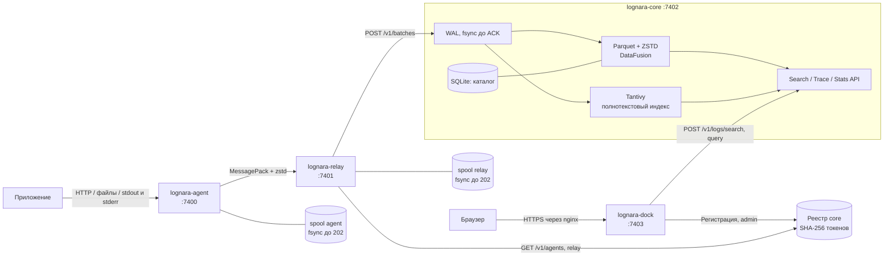

<div align="center">


# Lognara

**Сбор, хранение, поиск и аналитика логов на Rust**


</div>

Lognara принимает логи приложений, надёжно доставляет их на центральный сервер и позволяет искать по ним и строить статистику. Три небольших сервиса на Rust: **agent** живёт в контейнере рядом с приложением, **relay** один на машину, **core** хранит логи и отвечает на запросы. Веб-интерфейс **dock** показывает логи в браузере за nginx. Core пишет приём в WAL, сохраняет данные в сегменты Parquet + ZSTD, ищет через Tantivy и считает аналитику через DataFusion.

## Как это работает



1. Приложение отправляет лог (text, JSON или байты) на `POST http://127.0.0.1:7400/v1/logs`, либо агент читает его файлы и захватывает stdout/stderr через `lognara-agent run -- программа аргументы`.
2. Agent и relay подтверждают приём (`202`) только после durable-записи всей группы в spool и шлют дальше пачки MessagePack + zstd с персональным Bearer-токеном. Пока downstream недоступен, очереди остаются на диске и доставляются после восстановления.
3. Core подтверждает пачку (`204`) только после fsync WAL, затем материализует её в сегмент Parquet + ZSTD (аналитика DataFusion) и полнотекстовый индекс Tantivy.
4. Доставка допускает дубликаты: core дедуплицирует повтор одного тела по SHA-256. Гарантии и ограничения доставки описаны в [заметке о spool](Obsidian/LognaraVault/Delivery/Spool.md).

### Клиент .NET (Serilog)

Приложения на .NET 8+ отправляют логи через пакет `Serilog.Sinks.Lognara` (для дискового буфера на Windows — версия 0.1.2+):

```sh
dotnet add package Serilog.Sinks.Lognara
```

```csharp
using Serilog;

Log.Logger = new LoggerConfiguration()
    .WriteTo.Lognara("http://127.0.0.1:7400/v1/logs")
    .CreateLogger();

Log.Information("Заказ {OrderId} сохранён", 42);
await Log.CloseAndFlushAsync();
```

Пакет формирует канонический JSON, отправляет HTTP-пачки и поддерживает необязательный дисковый буфер. Подключение, лимиты и настройка: [Lognara-dotnet/README.md](Lognara-dotnet/README.md).

## Документация компонентов

Навигация по базе знаний проекта: [Obsidian/LognaraVault/Index.md](Obsidian/LognaraVault/Index.md).

| Компонент | Документация |
|-----------|--------------|
| [Lognara-agent](Lognara-agent) — приём HTTP, файлов и stdout/stderr, spool, отправка в relay | [руководство источников](Lognara-agent/docs/log-sources.md), [заметка agent](Obsidian/LognaraVault/Agent/LognaraAgent.md) |
| [Lognara-relay](Lognara-relay) — нормализация и доставка в core | [заметка relay](Obsidian/LognaraVault/Relay/LognaraRelay.md) |
| [Lognara-core](Lognara-core) — хранение, поиск, аналитика, API | [Lognara-core/README.md](Lognara-core/README.md), [эксплуатация](Lognara-core/docs/operations.md), [заметка core](Obsidian/LognaraVault/Core/LognaraCore.md) |
| [Lognara-dock](Lognara-dock) — веб-интерфейс за nginx | [Lognara-dock/README.md](Lognara-dock/README.md), [заметка dock](Obsidian/LognaraVault/Dock/LognaraDock.md) |
| [Lognara-spool](Lognara-spool) — общая файловая очередь | [заметка spool](Obsidian/LognaraVault/Delivery/Spool.md) |

Подключение [Nginx, PostgreSQL, Seq и MinIO](Lognara-agent/examples/log-sources/) и JSON-конфигурация источников описаны в [руководстве агента](Lognara-agent/docs/log-sources.md).

## Быстрый старт

Нужен Rust 1.94 или новее. Общего Cargo workspace нет, каждый сервис собирается отдельно:

```sh
cargo build --release --manifest-path Lognara-core/Cargo.toml --bin lognara-core
cargo build --release --manifest-path Lognara-relay/Cargo.toml
cargo build --release --manifest-path Lognara-agent/Cargo.toml
```

Сначала запускаются core и dock; relay и агенты создаются в dock на странице «Подключения». Токены показываются один раз: relay — `LOGNARA_CORE_TOKEN`, агент — `LOGNARA_RELAY_TOKEN`; при потере профиль удаляется и создаётся новый. Локальная альтернатива без dock — admin API (нужны `curl` и `jq`):

```sh
RELAY=$(curl -fsS http://127.0.0.1:7402/v1/admin/relays \
  -H 'Authorization: Bearer admin-secret' -H 'Content-Type: application/json' \
  -d '{"name":"local-relay"}')
AGENT=$(curl -fsS http://127.0.0.1:7402/v1/admin/agents \
  -H 'Authorization: Bearer admin-secret' -H 'Content-Type: application/json' \
  -d "{\"name\":\"local-agent\",\"relay_id\":$(printf '%s' "$RELAY" | jq -r '.relay.id')}")
export LOGNARA_RELAY_CORE_TOKEN=$(printf '%s' "$RELAY" | jq -r '.token')
export LOGNARA_AGENT_TOKEN=$(printf '%s' "$AGENT" | jq -r '.token')
```

Готовый стенд core + dock: [Example/docker-compose.yml](Example/docker-compose.yml) с `Example/.env.example`; нужны внешняя Docker-сеть `lognara-network` и htpasswd для dock ([руководство dock](Lognara-dock/README.md)).

Отправьте лог и найдите его:

```sh
curl -X POST http://127.0.0.1:7400/v1/logs \
  -H 'Content-Type: application/json' \
  -d '{"level":"error","message":"connection refused"}'

# через пару секунд
curl -X POST http://127.0.0.1:7402/v1/logs/search \
  -H 'Authorization: Bearer query-secret' \
  -H 'Content-Type: application/json' \
  -d '{"from":"2020-01-01T00:00:00Z","to":"2100-01-01T00:00:00Z","filters":{"level":["error"]},"text":{"query":"connection refused","mode":"phrase"}}'
```

Порты по умолчанию: agent `7400`, relay `7401`, core `7402`, dock `7403` (loopback). Все параметры задаются переменными окружения `LOGNARA_*` и проверяются при старте; полные списки — в документации компонентов выше; шаблон токенов для Compose ниже — `.env.example`.

## Образы контейнеров

Core, relay и dock публикуются из `master` после CI в `docker.barkfluff.com`:

- `docker.barkfluff.com/lognara-core`
- `docker.barkfluff.com/lognara-relay`
- `docker.barkfluff.com/lognara-dock`

Кроме числовых версий `major.minor.patch` публикуются обновляемый тег `master` и `sha-<полный SHA коммита>`; общий тег примеров выбирается `LOGNARA_IMAGE_TAG`, в `image` каждого сервиса можно указать числовой тег для фиксации. На хосте развёртывания: `docker login docker.barkfluff.com`, обновление — `docker compose pull && docker compose up -d`. Схема релизов и публикации: [Repository/Images](Obsidian/LognaraVault/Repository/Images.md).

Отдельного образа agent нет: агент поставляется статическими Linux-бинарниками из [GitHub Releases](https://github.com/Liis17/Lognara/releases) (`lognara-agent-linux-amd64.tar.gz`, `lognara-agent-linux-arm64.tar.gz`, `SHA256SUMS`) и копируется в образ приложения без сборки. Релиз содержит готовые Dockerfile и Compose для nginx со сбором stdout/stderr ([шаблон инструкции](Lognara-agent/docs/release-nginx.md)).

Локальная сборка из корня репозитория:

```sh
docker build -f Lognara-core/Dockerfile -t lognara-core .
docker build -f Lognara-relay/Dockerfile -t lognara-relay .
docker build -f Lognara-dock/Dockerfile -t lognara-dock .
```

### Центральный сервер: core + dock

Для dock подготовьте htpasswd и каталог данных по его [руководству](Lognara-dock/README.md):

```yaml
services:
  lognara-core:
    image: docker.barkfluff.com/lognara-core:${LOGNARA_IMAGE_TAG:-master}
    environment:
      LOGNARA_LISTEN_ADDR: "0.0.0.0:7402"
      LOGNARA_ADMIN_TOKEN: ${LOGNARA_CORE_ADMIN_TOKEN:?Задайте LOGNARA_CORE_ADMIN_TOKEN}
      LOGNARA_QUERY_TOKEN: ${LOGNARA_CORE_QUERY_TOKEN:?Задайте LOGNARA_CORE_QUERY_TOKEN}
    volumes:
      - ${LOGNARA_CORE_DATA:-lognara-core-data}:/var/lib/lognara-core
  lognara-dock:
    image: docker.barkfluff.com/lognara-dock:${LOGNARA_IMAGE_TAG:-master}
    environment:
      LOGNARA_DOCK_LISTEN_ADDR: "0.0.0.0:7403"
      LOGNARA_DOCK_PUBLIC_URL: https://dock.example.com
      LOGNARA_DOCK_CORE_URL: http://lognara-core:7402
      LOGNARA_DOCK_CORE_TOKEN: ${LOGNARA_CORE_QUERY_TOKEN:?Задайте LOGNARA_CORE_QUERY_TOKEN}
      LOGNARA_DOCK_CORE_ADMIN_TOKEN: ${LOGNARA_CORE_ADMIN_TOKEN:?Задайте LOGNARA_CORE_ADMIN_TOKEN}
    volumes:
      - ./auth:/etc/lognara-dock/auth
      - ./dock-data:/var/lib/lognara-dock
volumes:
  lognara-core-data:
```

### Машина приложений: relay + агенты

Адрес core замените на свой HTTPS-адрес:

```yaml
services:
  lognara-relay:
    image: docker.barkfluff.com/lognara-relay:${LOGNARA_IMAGE_TAG:-master}
    environment:
      LOGNARA_LISTEN_ADDR: "0.0.0.0:7401"
      LOGNARA_CORE_URL: https://core.example.com/v1/batches
      LOGNARA_CORE_TOKEN: ${LOGNARA_RELAY_CORE_TOKEN:?Задайте токен relay из dock}
      LOGNARA_RELAY_MEMORY_MB: ${LOGNARA_RELAY_MEMORY_MB:-2048}
    mem_limit: ${LOGNARA_RELAY_MEMORY_MB:-2048}m
    volumes:
      - ${LOGNARA_RELAY_DATA:-lognara-spool}:/var/lib/lognara-relay/spool
    networks: [lognara-ingest]
  app-with-agent:
    environment:
      LOGNARA_SERVICE: api
      LOGNARA_SERVER: docker-host
      LOGNARA_BACKEND: demo
      LOGNARA_RELAY_URL: http://lognara-relay:7401/v1/batches
      LOGNARA_RELAY_TOKEN: ${LOGNARA_AGENT_TOKEN:?Задайте токен агента из dock}
    volumes:
      - ${LOGNARA_AGENT_DATA:-lognara-agent-spool}:/var/lib/lognara-agent/spool
    networks: [lognara-ingest]
networks:
  lognara-ingest:
    driver: bridge
volumes:
  lognara-spool:
  lognara-agent-spool:
```

- Каждому процессу нужно отдельное постоянное хранилище с правом записи. Пустой `LOGNARA_*_DATA` создаёт volume, абсолютный путь монтирует папку на хосте; core храните на локальном диске, volumes сохраняйте при обновлении.
- `LOGNARA_RELAY_MEMORY_MB` задаёт RAM relay в MiB и лимит контейнера, минимум 2048.
- Relay слушает `0.0.0.0` внутри выделенной Docker-сети; порт 7401 на хост не публикуется.

## Метрики

Приложения пишут метрики в лог. Core понимает два источника: встроенный формат `ServiceMetrics` (`attributes.Metrics` c `SchemaVersion: 2`, `Counters` — приращения, `Gauges` — текущие значения) и правила с регулярным выражением, которые задаются в dock и применяются к новым событиям без пересчёта истории. Точки метрик не удаляются retention'ом; фон core строит почасовые и 12-часовые суточные агрегаты и читает старые сутки из них. Форматы, правила и лимиты: [Design/Metrics](Obsidian/LognaraVault/Design/Metrics.md) и [эксплуатация core](Lognara-core/docs/operations.md).

## HTTP API и эксплуатация

Маршруты и форматы core — поиск, trace, статистики, серии, admin: [Lognara-core/README.md](Lognara-core/README.md). Маршруты dock и мониторинг `/infrastructure`: [Lognara-dock/README.md](Lognara-dock/README.md).

Core работает одним процессом на каталог на локальном SSD; общие сетевые файловые системы и несколько писателей не поддерживаются. HTTPS обеспечивает внешний прокси (например, nginx). SIGTERM и SIGINT дорабатывают WAL, после аварийного завершения подтверждённые данные восстанавливаются из WAL. Эксплуатация и нагрузочный стенд: [operations](Lognara-core/docs/operations.md), [benchmark](Lognara-core/docs/benchmark.md).

## Разработка

GitHub Actions [CI](.github/workflows/ci.yml) запускается на push/PR во всех ветках и проверяет затронутые crate и веб-клиент: `fmt`, `clippy` с `-D warnings`, `cargo build --locked`, `cargo test --locked --all-features` (у core `--all-features` включает `crash-tests`), профили памяти agent/relay, сборку и тесты React-клиента. Итоговая проверка — `CI passed`. Локально то же самое из каталога crate:

```sh
cargo fmt --all --check && cargo clippy --locked --all-targets --all-features -- -D warnings && cargo build --locked && cargo test --locked --all-features
```

Схема CI: [Repository/CI](Obsidian/LognaraVault/Repository/CI.md).

## Структура репозитория

```text
Lognara-agent/            HTTP, файлы, stdout/stderr, spool и отправка в relay
  docs/log-sources.md     настройка источников, гарантии и запуск приложений
  examples/log-sources/   Nginx, PostgreSQL, Seq, MinIO и multiline
Lognara-relay/            разбор, группировка, spool, отправка в core
Lognara-spool/            общая атомарная файловая очередь
Lognara-core/             WAL, хранилище, поиск, аналитика, HTTP API
  docs/                   эксплуатация, нагрузочная проверка
Lognara-dock/             веб-интерфейс: вход, сессии, лента логов, Dockerfile
  web/                    React + TypeScript + Vite
Obsidian/LognaraVault/    база знаний проекта (открывается в Obsidian)
LICENSE                   MIT
```

## Статус и ограничения

- Версия 0.1.0, крейты не публикуются (`publish = false`).
- У agent нет Dockerfile и отдельного образа — поставка бинарниками из GitHub Releases; образы core, relay и dock публикуются в registry (см. раздел «Образы контейнеров»).
- Agent и relay передают текущую heartbeat-телеметрию; история и per-node dropped не реализованы.
- Сбор файлов и потоков универсален; Docker API, journald, syslog, архивы, CSV и внутренние базы приложений не читаются.
- Core работает на одной ноде: без кластера и репликации, TLS не встроен.
- 10 000 событий/с на 4 CPU / 8 GiB это проверяемая цель, а не гарантия.

## Лицензия

[MIT](LICENSE)

## Собственные логи Lognara

Core, dock и relay автоматически собирают свои сообщения в сервисы `lognara-core`, `lognara-dock` и `lognara-relay` (backend `lognara`). В Dock откройте «Настройки → Собственные логи Lognara»: переключатели действуют для всех экземпляров компонента. Там же есть ссылка на поиск собственных логов.

Агент в контейнер устанавливать не нужно; существующие серверные токены и тома данных используются автоматически. Сначала обновляйте core, затем dock и relay. При временной недоступности core сохраняется ограниченная дисковая очередь; новый сбор после переполнения может терять события. Консольные логи сохраняются. Контракты, квоты и поведение отключения: [собственные логи](Obsidian/LognaraVault/Delivery/SelfLogs.md).
