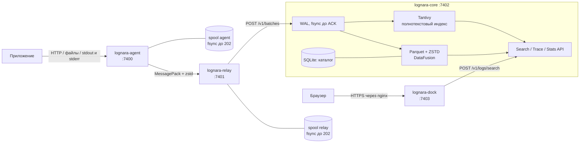

<div align="center">

# Lognara

**Сбор, хранение, поиск и аналитика логов на Rust**


</div>

Lognara принимает логи приложений, надёжно доставляет их на центральный сервер и позволяет искать по ним и строить статистику. Три небольших сервиса на Rust: **agent** живёт в контейнере рядом с приложением, **relay** один на машину, **core** хранит логи и отвечает на запросы. Веб-интерфейс **dock** показывает логи в браузере за nginx. Core пишет приём в WAL, сохраняет данные в сегменты Parquet + ZSTD, ищет через Tantivy и считает аналитику через DataFusion.

## Как это работает



1. Приложение отправляет лог (text, JSON или байты) на `POST http://127.0.0.1:7400/v1/logs`, либо агент читает его файлы и захватывает stdout/stderr через `lognara-agent run -- программа аргументы`.
2. Агент сохраняет весь запрос на диск до `202` и отправляет пачку в relay с общим Bearer-токеном, когда набрался `LOGNARA_BATCH_SIZE` или прошёл `LOGNARA_FLUSH_INTERVAL_MS`; размер пачки также ограничен байтами.
3. Relay проверяет ключ до чтения тела, разбирает записи в события и сохраняет все допустимые части запроса на диск до `202`. По количеству событий или таймеру отправляет сохранённые тела в core с Bearer-токеном. Пока downstream недоступен, обе очереди остаются на диске.
4. Core подтверждает пачку (`204`) только после fsync WAL, затем материализует её в сегмент и публикует для поиска и аналитики.

## Возможности

| Компонент | Что делает | Ключевые свойства |
|-----------|------------|-------------------|
| [`Lognara-agent`](Lognara-agent) | Принимает HTTP, читает файлы и stdout/stderr, сохраняет на диск, отправляет в relay | text/NDJSON/multiline для файлов и потоков; HTTP text/JSON/bytes; пачки MessagePack + zstd; точные повторы с backoff; переполнение HTTP даёт `503` без вытеснения |
| [`Lognara-relay`](Lognara-relay) | Разбирает записи в события, группирует по источнику, отправляет в core | spool на диске с лимитом; порядок пачек сохраняется; деление по байтовым лимитам core |
| [`Lognara-dock`](Lognara-dock) | Веб-интерфейс: вход и логи в реальном времени | вход по htpasswd (bcrypt) и passkey; сессии и ключи в SQLite; смена пароля переписывает htpasswd; SSE-лента по поиску core |
| [`Lognara-core`](Lognara-core) | Хранит логи, ищет и считает статистику | WAL + fsync до ACK; дедупликация по SHA-256; полнотекстовый поиск, trace lookup, гистограммы и group-by; retention; метрики Prometheus |

Подключение [Nginx, PostgreSQL, Seq и MinIO](Lognara-agent/docs/log-sources.md#подключение-приложений), JSON-конфигурация источников и режим `run` описаны в [руководстве агента](Lognara-agent/docs/log-sources.md).

### Гарантии доставки

- Корректные запросы, получившие `202` от agent или relay, восстановятся после перезапуска и временной недоступности downstream. Подтверждение следует после синхронизации всей группы на постоянном диске.
- Agent удаляет исходные данные после ACK relay, relay после ACK core. Квота и ошибки диска дают `503` без удаления принятой очереди. HTTP-отказы сохраняют данные и останавливают текущую попытку с диагностикой; повторы идут по таймеру/backoff. При `4xx` agent также приостанавливает новый приём.
- Доставка допускает дубликаты. Подготовленные тела повторяются теми же байтами; core дедуплицирует повтор одного тела по SHA-256. Повтор исходного запроса может получить новые ID событий.
- Отправляющее приложение должно повторять запросы без успешного ответа, в том числе после `503` или разрыва соединения. Его реализация не входит в проект.
- Файлы восстанавливаются по checkpoint после durable-записи в spool; crash между этими шагами допускает повторы. Сохраняйте несжатые ротации до дочитывания. stdout/stderr при перегрузке продолжают освобождаться с учётом потерь; консольная копия имеет отдельный счётчик потерь.
- Гарантия требует исправного постоянного хранилища. Повреждение или удаление диска, временные volumes и неподтверждённые запросы без повтора ею не покрываются.

## Быстрый старт

Нужен Rust 1.94 или новее. Общего Cargo workspace нет, каждый сервис собирается отдельно:

```sh
cargo build --release --manifest-path Lognara-core/Cargo.toml --bin lognara-core
cargo build --release --manifest-path Lognara-relay/Cargo.toml
cargo build --release --manifest-path Lognara-agent/Cargo.toml
```

Локальный запуск, три терминала (данные в `/tmp/lognara-demo`, токены произвольные):

```sh
# 1. core
LOGNARA_INGEST_TOKEN=ingest-secret \
LOGNARA_QUERY_TOKEN=query-secret \
LOGNARA_DATA_DIR=/tmp/lognara-demo/core \
Lognara-core/target/release/lognara-core

# 2. relay
LOGNARA_CORE_URL=http://127.0.0.1:7402/v1/batches \
LOGNARA_CORE_TOKEN=ingest-secret \
LOGNARA_RELAY_TOKEN=relay-secret \
LOGNARA_SPOOL_DIR=/tmp/lognara-demo/relay-spool \
LOGNARA_FLUSH_INTERVAL_MS=1000 \
Lognara-relay/target/release/lognara-relay

# 3. agent
LOGNARA_SERVICE=api \
LOGNARA_SPOOL_DIR=/tmp/lognara-demo/agent-spool \
LOGNARA_SERVER=local \
LOGNARA_BACKEND=demo \
LOGNARA_RELAY_TOKEN=relay-secret \
LOGNARA_RELAY_URL=http://127.0.0.1:7401/v1/batches \
LOGNARA_FLUSH_INTERVAL_MS=1000 \
Lognara-agent/target/release/lognara-agent
```

Для демо интервалы сокращены до секунды: по умолчанию relay отправляет раз в 60 секунд, а агент по умолчанию ищет relay по имени `lognara-relay` в сети контейнеров.

Отправьте лог и найдите его:

```sh
curl -X POST http://127.0.0.1:7400/v1/logs \
  -H 'Content-Type: application/json' \
  -d '{"level":"error","message":"connection refused"}'

# через пару секунд
curl -X POST http://127.0.0.1:7402/v1/logs/search \
  -H 'Authorization: Bearer query-secret' \
  -H 'Content-Type: application/json' \
  -d '{"from":"2020-01-01T00:00:00Z","to":"2100-01-01T00:00:00Z","filters":{"level":["error"]},"text":{"query":"connection refused","mode":"phrase"}}'
```

## Порты и параметры

Все параметры задаются переменными окружения `LOGNARA_*` и проверяются при старте; при ошибке сервис завершается с кодом 1 и называет переменную.

| Сервис | Порт по умолчанию | Обязательные | Главные необязательные |
|--------|-------------------|--------------|------------------------|
| agent | `127.0.0.1:7400` | `LOGNARA_SERVICE`, `LOGNARA_SERVER`, `LOGNARA_BACKEND`, `LOGNARA_RELAY_TOKEN` | `LOGNARA_RELAY_URL`, `LOGNARA_BATCH_SIZE` (1000), `LOGNARA_FLUSH_INTERVAL_MS` (5000) |
| relay | `127.0.0.1:7401` | `LOGNARA_CORE_URL`, `LOGNARA_CORE_TOKEN`, `LOGNARA_RELAY_TOKEN` | `LOGNARA_SPOOL_DIR`, `LOGNARA_SPOOL_MAX_MB` (1024), `LOGNARA_FLUSH_INTERVAL_MS` (60000), `LOGNARA_BATCH_SIZE` (10000) |
| core | `127.0.0.1:7402` | `LOGNARA_INGEST_TOKEN`, `LOGNARA_QUERY_TOKEN` | `LOGNARA_DATA_DIR`, `LOGNARA_RETENTION_SECONDS` (604800) |
| dock | `127.0.0.1:7403` | `LOGNARA_DOCK_PUBLIC_URL`, `LOGNARA_DOCK_CORE_URL`, `LOGNARA_DOCK_CORE_TOKEN` | `LOGNARA_DOCK_HTPASSWD_FILE`, `LOGNARA_DOCK_DATA_DIR`, `LOGNARA_DOCK_SESSION_TTL_SECONDS` (43200) |

<details>
<summary>Все параметры agent и relay</summary>

**agent**

| Переменная | По умолчанию | Назначение |
|---|---|---|
| `LOGNARA_SERVICE` | обязательна | имя сервиса |
| `LOGNARA_SERVER` | обязательна | сервер или нода |
| `LOGNARA_BACKEND` | обязательна | backend |
| `LOGNARA_ENVIRONMENT` | нет | окружение |
| `LOGNARA_SERVICE_INSTANCE` | `$HOSTNAME`, если задан | экземпляр сервиса |
| `LOGNARA_BATCH_SIZE` | `1000` | размер пачки в записях |
| `LOGNARA_FLUSH_INTERVAL_MS` | `5000` | как часто отправлять накопленное |
| `LOGNARA_MAX_BUFFER` | `100000` | лимит подтверждённых записей на диске, не меньше `BATCH_SIZE`; сверх него `503` |
| `LOGNARA_MAX_BUFFER_BYTES` | `67108864` | бюджет моделей, индекса, сериализации, источников и отправляемой пачки |
| `LOGNARA_SOURCES_FILE` | нет | JSON с файловыми источниками и настройками stdout/stderr для `run` |
| `LOGNARA_MAX_BATCH_BYTES` | `8388608` | максимум MessagePack и сжатой пачки, не более 8 MiB |
| `LOGNARA_MAX_RECORD_BYTES` | `2097152` | максимум payload одной записи, не более 2 MiB |
| `LOGNARA_SPOOL_DIR` | `/var/lib/lognara-agent/spool` | каталог постоянной очереди agent |
| `LOGNARA_SPOOL_MAX_MB` | `1024` | квота тел очереди; отдельно до 8 MiB для pending |
| `LOGNARA_LISTEN_ADDR` | `127.0.0.1:7400` | адрес приёма |
| `LOGNARA_RELAY_URL` | `http://lognara-relay:7401/v1/batches` | адрес relay |
| `LOGNARA_RELAY_TOKEN` | обязательна | общий Bearer-токен для отправки в relay |

**relay**

| Переменная | По умолчанию | Назначение |
|---|---|---|
| `LOGNARA_CORE_URL` | обязательна | адрес core, схема `http` или `https` |
| `LOGNARA_CORE_TOKEN` | обязательна | Bearer-токен для core |
| `LOGNARA_RELAY_TOKEN` | обязательна | общий Bearer-токен агентов |
| `LOGNARA_FLUSH_INTERVAL_MS` | `60000` | интервал отправки в core |
| `LOGNARA_BATCH_SIZE` | `10000` | при таком числе событий пачка уходит раньше интервала |
| `LOGNARA_MAX_BUFFER` | `100000` | лимит подтверждённых событий на диске; сверх него агенты получают `503` |
| `LOGNARA_LISTEN_ADDR` | `127.0.0.1:7401` | адрес приёма от агентов; для Docker задайте `0.0.0.0:7401` |
| `LOGNARA_SPOOL_DIR` | `/var/lib/lognara-relay/spool` | каталог spool |
| `LOGNARA_SPOOL_MAX_MB` | `1024` | лимит spool на диске |
| `LOGNARA_CORE_MAX_BODY_BYTES` | `67108864` | максимум сжатой пачки, не больше лимита core |
| `LOGNARA_CORE_MAX_DECODED_BYTES` | `268435456` | максимум MessagePack до сжатия, не больше лимита core |
| `LOGNARA_CORE_MAX_MODEL_BYTES` | `268435456` | бюджет модели, не больше лимита core |
| `LOGNARA_RELAY_MEMORY_BYTES` | `1879048192` | общий бюджет резервов приёма, буфера и sender |
| `LOGNARA_RELAY_MAX_MODEL_BYTES` | `268435456` | бюджет входной модели и нормализации |
| `LOGNARA_RELAY_MAX_BUFFER_BYTES` | `268435456` | байтовый резерв нормализованных моделей до commit |
| `LOGNARA_RELAY_MAX_INGEST_CONCURRENCY` | `1` | число одновременно читаемых/обрабатываемых пачек |

Параметры core (лимиты, память, сегменты, retention) описаны в [эксплуатации core](Lognara-core/docs/operations.md#конфигурация), все параметры dock, Docker, nginx и API в [`Lognara-dock/README.md`](Lognara-dock/README.md).

Agent обрабатывает один входящий запрос одновременно, читает до 2 MiB за 30 секунд. Бюджет 64 MiB учитывает capacity: 8 MiB отведено индексу (до 10922 частей), источники и два независимых конвейера приёма/отправки занимают остаток. При настроенных источниках дополнительный резерв равен `6 MiB + 3 * MAX_RECORD_BYTES` (12 MiB по умолчанию); без них 512 KiB резервируется для неблокирующей диагностики. Множество мелких JSON-элементов проверяется до создания payload. Отдельный резерв pending на диске позволяет отправлять при полной квоте. Пачка содержит до `BATCH_SIZE` записей, но может быть меньше из-за байтового или модельного бюджета и границ сохранённых частей.

Профиль relay рассчитан на процесс с 2 GiB: 1024 MiB на один входящий запрос, 256 MiB на нормализованные модели и 512 MiB на sender; 256 MiB оставлены для runtime, транспорта, индекса и allocator. Конфигурация проверяет сумму резервов без переполнения. Приём резервирует slot до чтения тела; чтение ограничено 64 MiB и 30 секундами, распаковка 256 MiB. Payload одной записи ограничен 2 MiB в обоих сервисах. Непомещающаяся запись/модель получает `413`; занятый slot, текущий дефицит памяти, квота spool и ошибки диска дают `503`. Relay сохраняет части каждого запроса отдельно и не объединяет подтверждённые запросы при отправке. Незавершённая группа не публикуется. Старые `.batch` читаются без перекодирования.

Резервы учитывают временные модели и сериализацию; они удерживаются до уничтожения объектов, включая отменённые blocking-задачи. Это бюджеты объектов, а не точный RSS: zstd, HTTP, runtime и allocator требуют дополнительной памяти. Для нагрузочной проверки: `python3 Lognara-agent/tests/check-memory-profile.py` и `python3 Lognara-relay/tests/check-memory-profile.py` (relay под 2 GiB).

</details>

## Общий ключ и Docker-сеть

Агент добавляет `Authorization: Bearer <LOGNARA_RELAY_TOKEN>` к каждой пачке и повторной попытке. Relay проверяет единственный заголовок авторизации до чтения тела и распаковки zstd. Без ключа, с неверным ключом или некорректной/дублированной авторизацией он отвечает `401` и `WWW-Authenticate: Bearer`; пачка не попадает в буфер или spool. При `401` агент сохраняет пачку, повторяет те же байты и приостанавливает новый приём с диагностикой; после исправления токена требуется перезапуск с прежним volume.

Ключ обязателен для обоих сервисов: пустые значения, пробелы, управляющие и не-ASCII символы вызывают ошибку запуска. Секрет не выводится в ошибках конфигурации и `Debug`. Для своей установки сгенерируйте случайный ключ:

```sh
cp .env.example .env
openssl rand -hex 32
# Впишите результат в LOGNARA_RELAY_TOKEN в .env.
# Так же сгенерируйте разные LOGNARA_CORE_TOKEN и LOGNARA_CORE_QUERY_TOKEN.
```

`.env` исключён из git. Compose использует его для подстановки `${...}`; передачу значения в контейнер задаёт `environment`. При запуске бинарников `.env` автоматически не читается: задайте переменные в окружении. [Документация Docker](https://docs.docker.com/compose/how-tos/environment-variables/variable-interpolation)

Ниже фрагмент для ваших существующих сервисов с настроенными `image`/`build`. `app-with-agent` обозначает контейнер приложения, в котором работает агент и принимает логи по localhost. Для agent, relay и core готовых образов и Dockerfile пока нет. `LOGNARA_CORE_TOKEN` это ingest-токен core, `LOGNARA_CORE_QUERY_TOKEN` его query-токен; оба отличаются от общего ключа агентов и друг от друга. Если core работает вне этого Compose, уберите сервис `lognara-core` и задайте relay его HTTPS-адрес в `LOGNARA_CORE_URL`.

```yaml
services:
  lognara-core:
    environment:
      LOGNARA_LISTEN_ADDR: "0.0.0.0:7402"
      LOGNARA_INGEST_TOKEN: ${LOGNARA_CORE_TOKEN:?Задайте LOGNARA_CORE_TOKEN}
      LOGNARA_QUERY_TOKEN: ${LOGNARA_CORE_QUERY_TOKEN:?Задайте LOGNARA_CORE_QUERY_TOKEN}
    volumes:
      - ${LOGNARA_CORE_DATA:-lognara-core-data}:/var/lib/lognara-core
    networks: [lognara-core]
  lognara-relay:
    environment:
      LOGNARA_RELAY_TOKEN: ${LOGNARA_RELAY_TOKEN:?Задайте LOGNARA_RELAY_TOKEN}
      LOGNARA_LISTEN_ADDR: "0.0.0.0:7401"
      LOGNARA_CORE_URL: http://lognara-core:7402/v1/batches
      LOGNARA_CORE_TOKEN: ${LOGNARA_CORE_TOKEN:?Задайте LOGNARA_CORE_TOKEN}
    volumes:
      - ${LOGNARA_RELAY_DATA:-lognara-spool}:/var/lib/lognara-relay/spool
    networks: [lognara-ingest, lognara-core]
  app-with-agent:
    environment:
      LOGNARA_SERVICE: api
      LOGNARA_SERVER: docker-host
      LOGNARA_BACKEND: demo
      LOGNARA_RELAY_URL: http://lognara-relay:7401/v1/batches
      LOGNARA_RELAY_TOKEN: ${LOGNARA_RELAY_TOKEN:?Задайте LOGNARA_RELAY_TOKEN}
    volumes:
      - ${LOGNARA_AGENT_DATA:-lognara-agent-spool}:/var/lib/lognara-agent/spool
    networks: [lognara-ingest]
networks:
  lognara-ingest:
    driver: bridge
  lognara-core:
    driver: bridge
volumes:
  lognara-core-data:
  lognara-spool:
  lognara-agent-spool:
```

Всем трём сервисам обязательно постоянное хранилище с правом записи. По умолчанию данные лежат в Docker volumes. Чтобы хранить их в папке на хосте, задайте в `.env` абсолютный путь в `LOGNARA_AGENT_DATA`, `LOGNARA_RELAY_DATA` или `LOGNARA_CORE_DATA`, например `/srv/lognara/relay`; пустое значение оставляет volume. Создайте папку заранее и дайте право записи пользователю контейнера. Core держите на локальном диске, не на сетевой ФС. Каждый agent использует свой каталог/volume; два процесса не могут одновременно владеть одним spool. Не удаляйте volumes и папки при обновлении. Квоты тел не заменяют свободное место для файловой metadata и одной временной группы.

В контейнере relay нужен `0.0.0.0`, чтобы принимать соединения от соседних контейнеров. Порт `7401` не публикуйте через `ports`, а `network_mode: host` не используйте. Агенты обращаются к контейнерному порту по имени `lognara-relay` в выделенной Docker-сети; доступ к этой сети предоставляйте доверенным контейнерам. [Документация Docker](https://docs.docker.com/compose/how-tos/networking/)

Все владельцы общего ключа доверенные: relay принимает заявленные ими `service/server/backend` без проверки принадлежности. Новому контейнеру достаточно подключения к сети и того же ключа; изменять конфигурацию relay не нужно. При смене ключа пересоздайте контейнеры relay и всех агентов с новым значением; автоматической ротации нет.

## Обновление

1. Сначала восстановите downstream и доставьте остатки старых очередей в RAM: старые версии не сохраняют подтверждённую очередь полностью.
2. Обновите relay, сохранив его spool volume и согласованные лимиты core. Проверьте доставку старых `.batch`.
3. Обновите agent с отдельным постоянным volume; приложение должно повторять неподтверждённые запросы.
4. Проверьте backlog и доставку после восстановления downstream. При ошибке чтения/изменении сохранённого файла приём закрывается; после устранения причины перезапустите процесс с прежним каталогом.

## HTTP API core

| Метод и путь | Токен | Назначение |
|--------------|-------|------------|
| `POST /v1/batches` | ingest | приём пачки от relay, `204` после fsync WAL |
| `POST /v1/logs/search` | query | поиск по фильтрам и тексту, курсорная пагинация |
| `GET /v1/traces/{trace_id}` | query | события trace по возрастанию времени |
| `POST /v1/stats/histogram` | query | число событий по временным корзинам |
| `POST /v1/stats/group-by` | query | число событий по 1-2 полям |
| `GET /metrics` | query | метрики Prometheus |
| `GET /health/live`, `GET /health/ready` | нет | живость и готовность |

Форматы запросов и ответов, лимиты и коды ошибок: [`Lognara-core/README.md`](Lognara-core/README.md).

## Эксплуатация

Один процесс core владеет одним каталогом на локальном SSD; общая сетевая файловая система и несколько писателей не поддерживаются. HTTPS обеспечивает внешний прокси (например, nginx), core слушает loopback. SIGTERM и SIGINT завершают приём и дорабатывают WAL, после аварийного завершения подтверждённые данные восстанавливаются из WAL.

- [Эксплуатация core](Lognara-core/docs/operations.md): конфигурация, systemd и nginx, восстановление, retention, метрики.
- [Нагрузочная проверка](Lognara-core/docs/benchmark.md): стенд и критерии.

## Разработка

Тесты, форматирование и линтер запускаются для каждого сервиса отдельно:

```sh
cargo test   --manifest-path Lognara-core/Cargo.toml --all-features
cargo fmt    --manifest-path Lognara-core/Cargo.toml --check
cargo clippy --manifest-path Lognara-core/Cargo.toml --all-targets --all-features -- -D warnings
```

Те же команды с `Lognara-agent/Cargo.toml` и `Lognara-relay/Cargo.toml`. Тесты core запускают настоящие agent и relay (dev-зависимости) и проверяют повтор после рестарта, SIGKILL после ACK, сбои публикации, индексы, курсоры и retention. Feature `crash-tests` включает только аварийные точки для тестов, для эксплуатации собирайте без неё.

Тяжёлая проверка профиля relay запускается отдельно (Python 3, macOS/Linux):

```sh
python3 Lognara-relay/tests/check-memory-profile.py
```

Она собирает отдельный тест, проверяет большие тела, конкурентный приём и shutdown при недоступном core; останавливает процесс при RSS выше 2 GiB и проверяет пиковый RSS ядра. Компиляция не измеряется, генератор фикстур измеряется вместе с relay. Локальный пик relay на macOS arm64/debug — 1672,4 MiB; повторный прогон — 1617,5 MiB. Профиль agent с 30 секундами заполненной очереди при недоступном relay показал 86,1 MiB; с источниками — 78,6 MiB (порог 128 MiB, бюджет объектов 64 MiB); все подтверждённые записи доставились после восстановления. Жёсткая квота Linux cgroup/container здесь не проверялась; перед deployment повторите нагрузку с лимитом 2 GiB. Подробности: [память relay](Obsidian/LognaraVault/Relay/Memory.md).

## Структура репозитория

```text
Lognara-agent/            HTTP, файлы, stdout/stderr, spool и отправка в relay
  docs/log-sources.md     настройка источников, гарантии и запуск приложений
  examples/log-sources/   Nginx, PostgreSQL, Seq, MinIO и multiline
Lognara-relay/            разбор, группировка, spool, отправка в core
Lognara-spool/            общая атомарная файловая очередь
Lognara-core/             WAL, хранилище, поиск, аналитика, HTTP API
  docs/                   эксплуатация, нагрузочная проверка
Lognara-dock/             веб-интерфейс: вход, сессии, лента логов, Dockerfile
  web/                    React + TypeScript + Vite
Obsidian/LognaraVault/    база знаний проекта (открывается в Obsidian)
LICENSE                   MIT
```

## Статус и ограничения

- Версия 0.1.0, крейты не публикуются (`publish = false`).
- Dockerfile есть только у dock; для agent, relay и core образов пока нет.
- Метрики агента и relay не поддерживаются; потери захвата потоков учитываются в диагностике агента.
- Сбор файлов и потоков универсален; Docker API, journald, syslog, архивы, CSV и внутренние базы приложений не читаются.
- Core работает на одной ноде: без кластера и репликации, TLS не встроен.
- 10 000 событий/с на 4 CPU / 8 GiB это проверяемая цель, а не гарантия. Результаты приёмочного прогона ещё не записаны.

## Лицензия

[MIT](LICENSE)
